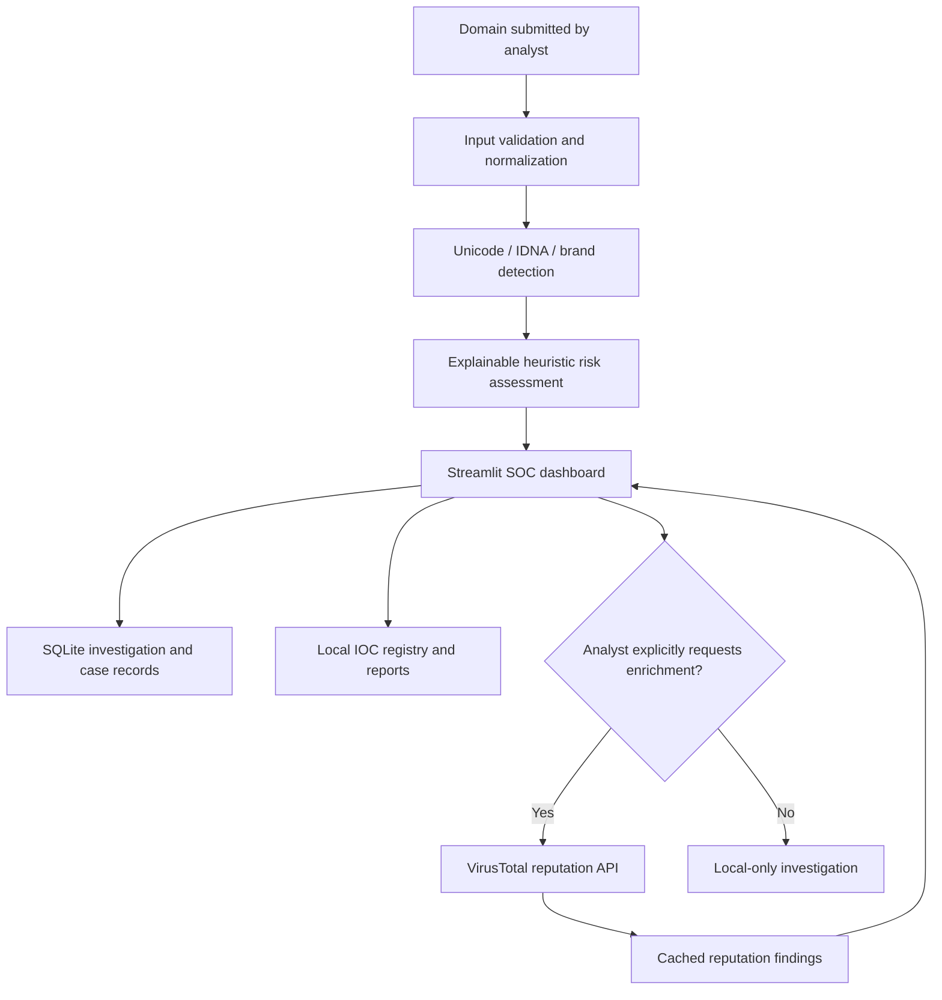

# 🛡️ Homograph Defense Lab

**SOC Investigation Console · Phishing Domain Analysis · Threat Intelligence**

*A hands-on cybersecurity project demonstrating suspicious-domain detection, explainable analysis, and structured SOC case management.*

**[🎥 Video demonstration](../../releases/latest)** · **[Features](#-key-capabilities)** · **[Architecture](#-architecture)** · **[LinkedIn](https://www.linkedin.com/in/gdamouzou)**

> **Public portfolio showcase.** This repository contains documentation and demonstration material only. Source code, detection modules, and local investigation records are maintained in a separate **private** repository. The video link will become active after the demonstration is published as a GitHub Release.

## 🎥 Project demonstration

A short recording of the working Streamlit SOC console. It showcases domain investigations, risk indicators, history, and detection-testing workflows.

**[▶ Watch the demonstration (GitHub Releases)](../../releases/latest)**

### Dashboard previews

| SOC console | Investigation view |
|:---:|:---:|
|  |  |
|  |  |

*Screenshots are from the project demonstration; any test data is illustrative.*

## 🎯 Security problem

Lookalike domains can exploit Unicode confusables, Punycode, typosquatting, and misleading subdomains to resemble legitimate brands. These techniques complicate phishing triage. **Homograph Defense Lab** provides a controlled environment to inspect suspicious domains, explain the indicators behind a heuristic assessment, and document an analyst investigation.

## 🔍 Key capabilities

| Area | What the lab demonstrates |
| --- | --- |
| Domain inspection | Unicode, Punycode/IDNA, script mixing, confusable-character indicators |
| Impersonation analysis | Brand resemblance, typosquatting indicators, registered-domain structure |
| Explainable scoring | Heuristic risk levels with supporting reasons; not a definitive malicious verdict |
| SOC case management | Analyst assignment, priority, status, verdict, evidence, and case timeline |
| Investigation history | Local SQLite storage and structured report exports |
| Local threat intelligence | Analyst-maintained indicators of compromise (IOCs) |
| Optional external enrichment | Explicitly authorized VirusTotal domain-reputation lookups with caching |
| Validation | Scenario-based detection testing and a pytest suite |

## 🧩 Architecture

**Investigation safety:** Domain analysis is passive. External enrichment is opt-in and separate from the lab's own heuristic scoring.

## 🧪 Example SOC workflow

1. Submit a potentially deceptive domain in the investigation console.
2. Review its registered-domain structure, character composition, and brand similarity.
3. Inspect the risk score **and the indicators behind it**.
4. Optionally request third-party reputation enrichment.
5. Record an investigation, assign priority and analyst, add a verdict, and export a report.

## ✅ Testing evidence

During v4.3 development, **107 pytest tests passed** locally, including **14 threat-enrichment tests**. The recorded interface was manually demonstrated. These results do not imply production readiness or establish that a live VirusTotal request succeeded in the video.

## 🛠️ Technology stack

**Python 3.11 · Streamlit · SQLite · Pandas · Pytest · Unicode/IDNA · Public Suffix List · VirusTotal API**

## 🔐 Scope and source availability

- Educational portfolio project, **not** a commercial threat-detection service.
- Risk scoring is heuristic: a suspicious result is not automatically a confirmed phishing verdict, and a low score does not establish safety.
- The project does not execute suspicious URLs or automatically block domains.
- The source is held privately; an interview-focused technical walkthrough can be arranged.

## 🗺️ Roadmap

- Correlation between local indicators and cached reputation findings
- Expanded evidence provenance and analyst reporting
- Automated CI and additional integration tests
- Improved visualization of SOC investigation metrics

## 👤 Author

**Germain Daakpo Amouzou** — Bilingual IT & Cybersecurity Professional (English / French)

[GitHub profile](https://github.com/Daakpo) · [LinkedIn](https://www.linkedin.com/in/gdamouzou)

*Demonstrating practical security analysis, investigative reasoning, and Python-based SOC tooling.*
